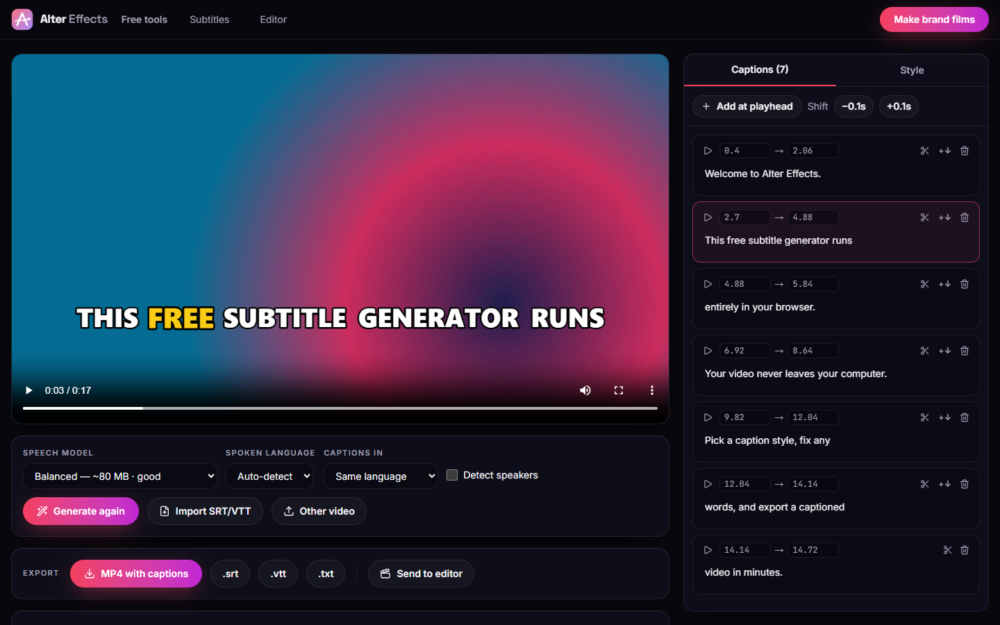

# Alter Effects

Editorial motion-graphics videos from an organisation's **own** footage, pages and people — with **any AI** the customer connects (Claude, ChatGPT, Gemini, OpenRouter, or any OpenAI-compatible router such as 9Router, LiteLLM or Ollama) or a managed default that falls back across providers.

The AI never writes animation code. It tags assets and fills a **recipe's** slots; the recipe (versioned TypeScript) designs every frame deterministically; code **gates** check the result; a headless-Chrome renderer produces a frame-accurate MP4 with a generated score.

```
Web (Next.js) ──jobs──▶ Postgres queue ──▶ Worker ──▶ ingest · tag(AI) · storyboard(AI) · compose · gates · render
     │                                     │
     └──────── Postgres (Prisma) ◀─────────┘         S3-compatible storage (RustFS locally, R2/S3 in prod)
```

## What's in the repo

| Path | What it is |
|---|---|
| `packages/engine` | Recipe SDK, 10 recipes in 4 families, browser runtime (scene library, gates, generated score), renderer (Chrome + ffmpeg), claims gate, SRT/VO sheet |
| `packages/ai` | One adapter interface over Anthropic, OpenAI, Gemini, OpenRouter and any OpenAI-compatible router (9Router, LiteLLM, Ollama…), with provider fallback chains; schema-validated JSON with a repair retry; tagging + storyboard prompts; Whisper transcription; TTS |
| `packages/db` | Prisma schema: organisations → brands → assets/videos, members & roles, encrypted provider keys, model routing, jobs, renders, credits, payments |
| `packages/shared` | Plans/credits, queue payloads, AES-256-GCM key encryption, S3 storage helpers |
| `apps/worker` | Job processors on a Postgres queue: asset ingest/tag/transcribe, web-page screenshots, YouTube channel import, storyboard, render (charge once, refund on failure), face-tracked effects |
| `packages/fx` | Vendored effects engine (Python: OpenCV, MediaPipe, Pillow) with 51 face-tracked effects, plus the catalogue and plan validation the app uses |
| `apps/web` | Next.js app: auth, orgs & invites, brand kit, asset library, video wizard, storyboard editor & approval, live review player (plays a storyboard from its code with no render; frame-pinned and drawn review notes sent to the AI as a redraft, then checked before/after), AI provider settings & routing, recipes & variants, Razorpay billing |
| `packages/cli` | Agent kit: `altereffects recipes / init / catalog / check / render` + `skill/SKILL.md` for Claude Code, Codex, Gemini CLI |

### Recipes

| Family | Recipes |
|---|---|
| Kinetic type | `kinetic.manifesto`, `kinetic.launch-teaser`, `kinetic.offer` |
| Brand documentary | `documentary.founder-story`, `documentary.journey-film` |
| Social proof | `proof.portrait-wall`, `proof.logo-wall` |
| Captioned reels | `captions.talking-head`, `captions.podcast-clip`, `captions.event-recap` |

A recipe = slot schema (zod) + design sheet (the AI's instructions) + `compose()` (slots → scene document) + sample. Add one in `packages/engine/src/recipes/`, register it in `recipes/index.ts`; no other platform change.

## Free tools (no sign-up, nothing uploaded)

Two tools run entirely in the browser and need no database, worker, AI key or account:

| Page | What it does |
|---|---|
| `/tools/subtitles` | **Subtitle generator.** Transcribes speech with Whisper on the device (transformers.js; WebGPU when available, otherwise WASM), with word-level timings. Can **translate to English** and **label up to 3 speakers** (pyannote segmentation). Long videos use overlapping 30-second windows plus a gap-filling pass, so no words are lost at window edges. You can edit, split, merge, re-time and re-assign speakers. Nine styles: Classic, Boxed, Bold pop, Karaoke, Highlight box, One word, Minimal, Neon and Typewriter, each with editable font, colours, outline, glow, position, word highlight and colour per speaker. Exports **SRT, VTT, TXT (optionally with speaker labels) or a burned-in MP4** (WebCodecs via Mediabunny). **Send to editor** opens the video and its captions in the editor. |
| `/tools/editor` | **Video editor.** A magnetic main track for clips and photos: trim by dragging edges, split (`S`), reorder by dragging, duplicate, per-clip **speed** (0.25–4×), **transitions** (crossfade, slide, wipe, zoom), cover/contain fit and volume. A **picture-in-picture** overlay track, titles, background music that loops and fades out, and **waveforms** on every audio track. **Auto-captions are anchored to their footage**, so they follow trims, splits, reorders and speed changes; SRT import is also supported. **Face-tracked effects** (13 of them, such as Spotlight, Backdrop word, Lean in, Locked on and Reject stamp) follow the person in the shot with MediaPipe running on the device. Undo/redo and keyboard shortcuts. Exports **MP4 in 16:9, 9:16 or 1:1 at 720p, 1080p or 4K and 24/30/60 fps**. |

Both tools **autosave in the browser** (IndexedDB, including the media files), so a refresh or a closed tab doesn't lose work.

The caption renderer (`apps/web/src/tools/captions.ts`) and the frame compositor (`composeFrame` in `apps/web/src/tools/editor/model.ts`) draw both the live preview and the exported frames, so the export matches the preview. The speech-model runtime (ONNX Runtime Web) is served from the app's own origin: `scripts/copy-runtimes.mjs` copies it into `public/ort`, and the MediaPipe WASM into `public/mediapipe/wasm`, before `dev` and `build`. The two small face/person models (about 480 KB) are committed in `public/mediapipe/models`. Only the model weights (40–250 MB) download from the Hugging Face Hub, once, and they stay in the browser cache. Requires a WebCodecs browser (recent Chrome, Edge or Safari).

| Subtitle generator | Caption styles | Video editor |
|---|---|---|
|  |  |  |

- **Interface languages:** English, Hindi (हिन्दी) and Telugu (తెలుగు). Switch from the header or link with `?ui=hi` / `?ui=te`; the choice is remembered. Strings live in `apps/web/src/tools/locales/` with the English text as the key, and a test fails if any interface string lacks a translation. Native speakers: please review and send fixes.
- **Search landing pages:** `/tools/subtitles/<slug>`, one per language (Hindi, Telugu, Tamil, Marathi, Bengali, Spanish) and per use case (YouTube, Instagram Reels, TikTok, podcasts, courses, translation). Each has its own copy, FAQ structured data and a preset link (`?lang=…&style=…&translate=1&speakers=1&model=accurate`) that opens the tool configured for that case. Add pages in `apps/web/src/tools/landing.ts`. `sitemap.xml`, `robots.txt` and social-share images are generated by the app.
- **Effects in the main app:** for any ready video in a brand, *Add effects* opens a planner with all 51 effects from `packages/fx`. The worker runs them with Python and saves the result as a new asset. The worker needs Python 3.10+ with `pip install -r packages/fx/requirements.txt`; set `FX_PYTHON` if it isn't `python3` (or `python` on Windows). The worker Docker image already includes it.
- **Into the main app:** *Use in Alter Effects* uploads the video and its captions to one of your brands and opens the *Captioned talking head* recipe. The on-device transcript is reused, so no paid transcription is needed. Signed-out users are sent to sign up and come back to their autosaved session.

## Self-host with Docker (one command)

```bash
cp .env.example .env          # set AUTH_SECRET and KEY_ENCRYPTION_KEY
docker compose --profile app up -d --build
```

This starts Postgres, S3-compatible storage (RustFS), a one-shot schema migration, the render worker (Chromium + ffmpeg) and the web app at **http://localhost:3000**. Useful variables, set in `.env` or the shell:

| Variable | Default | Use |
|---|---|---|
| `APP_URL` | `http://localhost:3000` | Public URL (links in emails, canonical URLs, CSP). Baked into the web image at build time. |
| `WEB_PORT` | `3000` | Host port for the web app. |
| `S3_PUBLIC_ENDPOINT` | `http://localhost:9000` | Storage address browsers use for signed media links (the containers use `http://s3:9000`). Baked into the CSP at build time. |
| `POSTGRES_USER` / `POSTGRES_PASSWORD` / `POSTGRES_DB` | `altereffects` | Database credentials (must match an existing volume). |

Scale rendering with `docker compose --profile app up -d --scale worker=3`. For production, put a TLS proxy (Caddy, Traefik, nginx or a CDN) in front of the web app and set `APP_URL` to the `https://` address.

## Run with hosted services (no Docker): Neon + Cloudflare R2

The app needs only **Postgres** (data, job queue, rate limits) and **S3-compatible storage** (media). No Redis.

1. **Neon:** create a project at console.neon.tech → *Connect* → copy the **direct** connection string (host without `-pooler`) into `DATABASE_URL`, keeping `?sslmode=require`.
2. **Cloudflare R2:** create a bucket, then an API token with *Object Read & Write* on it. Set `S3_ENDPOINT=https://<ACCOUNT_ID>.r2.cloudflarestorage.com`, `S3_REGION=auto`, `S3_BUCKET`, `S3_ACCESS_KEY_ID`, `S3_SECRET_ACCESS_KEY`. In the bucket's *Settings → CORS*, allow `GET` and `PUT` from your `APP_URL`.
3. Run:

```bash
npm install
npm run db:generate && npm run db:push
npm run dev
```

## Run locally

Requirements: Node 20+, Docker Desktop, ffmpeg on PATH, Google Chrome.

```bash
cp .env.example .env              # then set AUTH_SECRET and KEY_ENCRYPTION_KEY (see comments)
npm install
npm approve-scripts @prisma/client prisma @prisma/engines && npm rebuild prisma @prisma/client
npm run infra:up                  # Postgres :5433, RustFS (S3) :9000 — or skip: use Neon + Cloudflare R2 (see below)
npm run db:generate && npm run db:push
npm run dev                       # web on http://localhost:3000 + worker
```

Then: sign up → add a brand → upload footage/photos/logo (or paste pages / your YouTube channel) → Settings → AI providers (paste a key, pick models per stage) → New video.

No AI key yet? Use **"Start from the recipe example (no AI)"** in the video wizard, edit the storyboard by hand, and render.

Bulk import a local folder into a brand:

```bash
cd apps/worker
npx tsx --env-file=../../.env scripts/import-folder.ts <brandId> VIDEO ./footage
npx tsx --env-file=../../.env scripts/import-folder.ts <brandId> THUMBNAIL ./people --people people.json
```

Render a recipe from local files without the database or AI (kinetic recipes need no footage):

```bash
cd packages/engine
npx tsx scripts/render-sample.ts kinetic.manifesto 9:16 --full                            # 1080p, no assets needed
npx tsx scripts/render-sample.ts documentary.journey-film 16:9 --assets ./my-assets       # preview from your own footage
npx tsx scripts/showcase.ts                                                                # re-render the marketing-site showcase
```

`--assets` follows the CLI folder convention: file name = asset id; `logos/`, `pages/` and `people/` sub-folders set the kind (optional `people.json` with names).

### Checks

```bash
npm run typecheck                 # shared, engine, ai, db, worker, cli
npm test                          # offline recipe tests: every recipe × aspect composes, deterministic, valid media refs; claims gate; SRT
npm run build                     # Next.js production build (also type-checks the web app; needs no Postgres)
npx playwright install chromium   # once
npm run e2e                       # browser tests: free tools (import, export MP4, languages, editor), signup → brand → video, auth, headers
```

`npm run e2e` needs Postgres and storage (`npm run infra:up`) and starts `next start` on port 3100 (run `npm run build` first). To reuse a running dev server instead: `E2E_BASE_URL=http://localhost:3100 npm run e2e`. Set `TRUST_PROXY=false` on that server, or repeated sign-ups from one IP will hit the rate limit.

### Production notes

- Images: `apps/web/Dockerfile` (Next.js standalone) and `apps/worker/Dockerfile` (Chromium + ffmpeg). See **Self-host with Docker**. Scale render workers horizontally with `RENDER_CONCURRENCY=1` per container.
- Storage: point `S3_*` at Cloudflare R2 or S3. Web uploads stream through `/api/uploads/[id]`.
- Billing: Razorpay **test** keys in `.env`; webhook `{APP_URL}/api/razorpay/webhook` for `payment.captured`.
- Managed AI: set `MANAGED_ANTHROPIC_API_KEY` to offer AI without a customer key.
- Email: set `SMTP_URL` and `MAIL_FROM` for password-reset and invite emails. Without them, emails are printed to the server log.
- Security: rate limits use Redis and key on the client IP from proxy headers. Run behind a proxy or CDN that sets `X-Forwarded-For` / `CF-Connecting-IP`, or set `TRUST_PROXY=false`. The Content-Security-Policy is built at `next build` from `S3_PUBLIC_ENDPOINT` (or `S3_ENDPOINT`) and `CSP_EXTRA_ORIGINS`, and HSTS turns on when `APP_URL` is `https://`. See [SECURITY.md](SECURITY.md).

## Pipeline

| Stage | Type | Notes |
|---|---|---|
| Ingest | CODE | probe, scene cuts, thumbnails, contact sheet; web pages screenshotted (overlays hidden, no consent clicked) |
| Tag | AI (vision) | real / stock / AI, faces, caption zones, usability, people's names only if printed |
| Recipe draw | CODE | recipes the assets can fill, seeded |
| Storyboard | AI | fills slots, VO per scene, sources for every claim; unknown asset ids are repaired once |
| Approve | USER | the single stop; credits charged here, once |
| Compose | CODE | deterministic scene document |
| Gates | CODE | safe zones, text over faces, contrast; mechanical fix ladder (max 2 cycles, no redesign); claims gate on storyboard |
| Render | CODE | frame-accurate capture, generated score, VO ducking, −14 LUFS, MP4 + poster + SRT + VO sheet + project JSON |

Ideas adopted from VEED's [OpenEdit](https://github.com/veedstudio/open-edit) (Apache-2.0 editor): compiled recipes, SCRIPT/AGENT split, one money gate, mechanical gates, seeded style draw, reference canvases, loudness target, agent-skill distribution. No OpenEdit code or renderer binaries are used.

## Contributing

See [CONTRIBUTING.md](CONTRIBUTING.md). In short: `npm run typecheck && npm test && npm run build` must pass, and a new recipe needs a `sample()` that fits its own slot schema (the tests check it).

## License

[Apache-2.0](LICENSE). Third-party components keep their own licenses — notably GSAP, which the renderer loads at render time under GSAP's no-charge "Standard" license rather than an open-source one. See [THIRD_PARTY_NOTICES.md](THIRD_PARTY_NOTICES.md).

Only render footage, photos and pages you own or have rights to. The marketing site's showcase videos are rendered from the built-in demo brand (`packages/engine/scripts/showcase.ts`).
