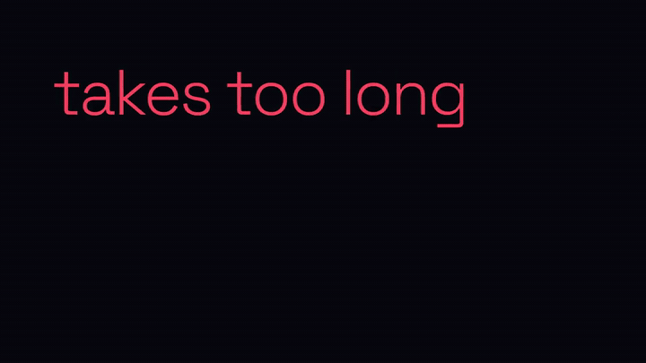
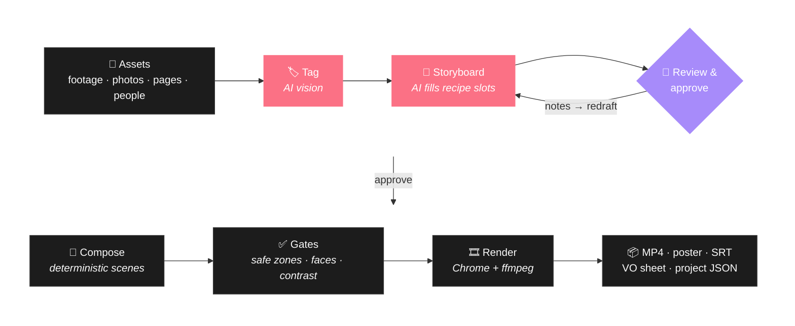
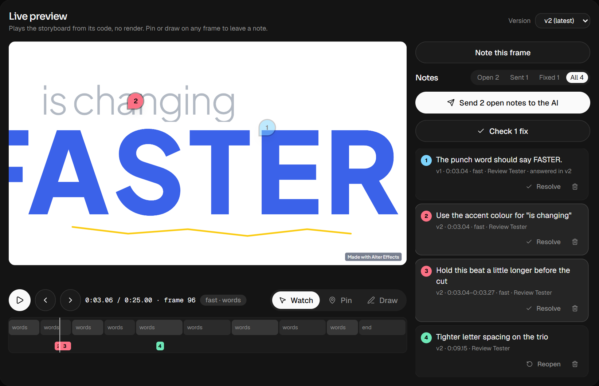
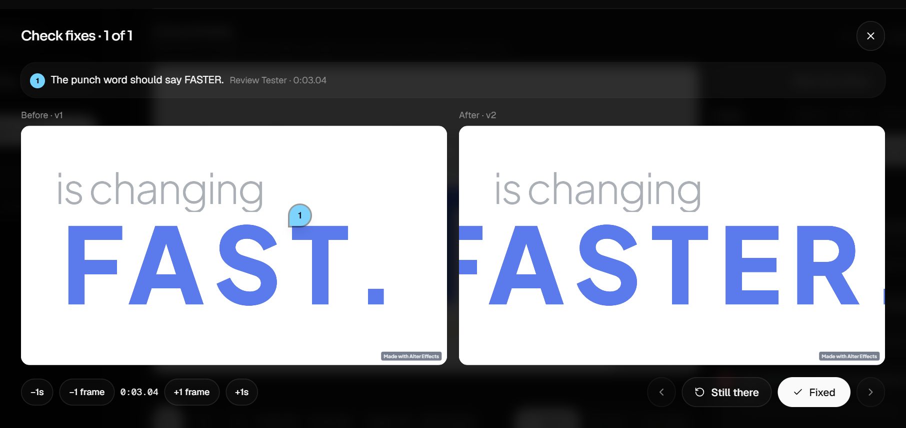
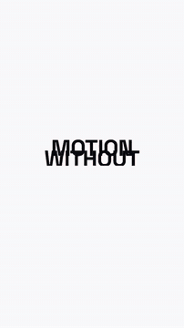
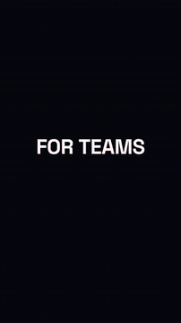
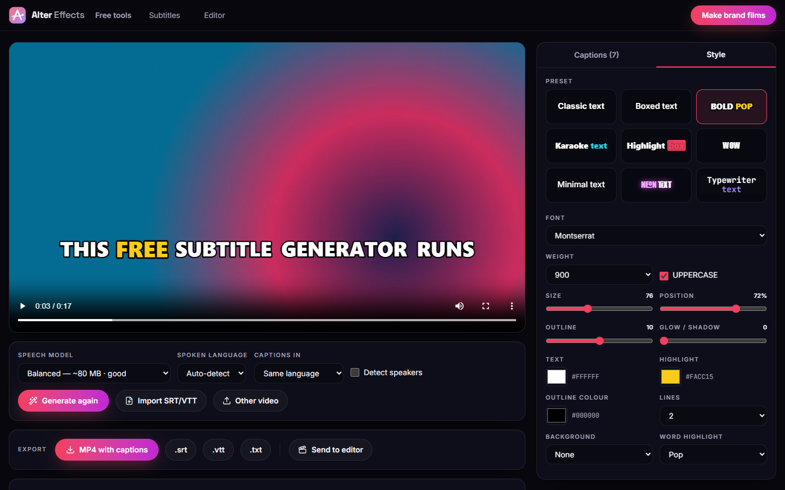
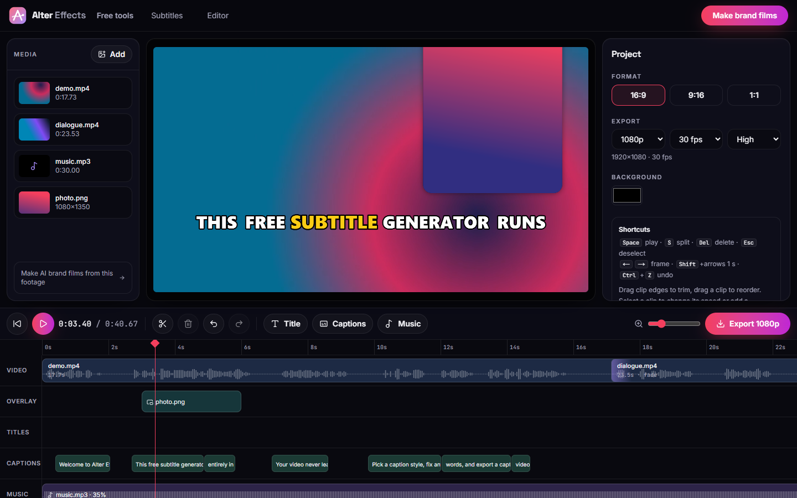
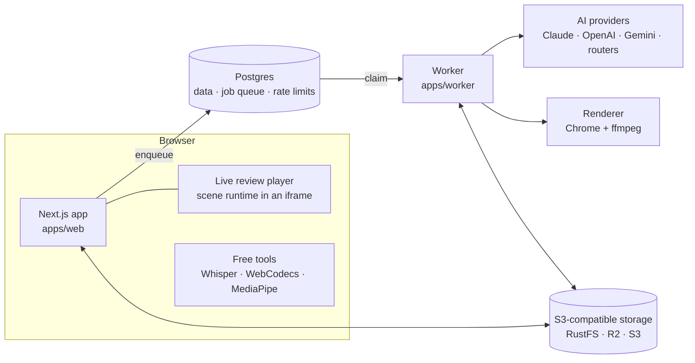

<div align="center">


# Alter Effects

**Editorial motion-graphics videos from your own footage, pages and people, with any AI you connect.**

The AI writes the story. Versioned recipes design every frame. Code checks the result.<br/>
A headless-Chrome renderer delivers a frame-accurate MP4 with a generated score.

[](LICENSE)
[](package.json)
[](apps/web)
[](CONTRIBUTING.md)

[Quick start](#-quick-start) · [How it works](#-how-it-works) · [Review studio](#-review-studio) · [Recipes](#-recipes) · [Free tools](#-free-tools) · [Self-host](#-self-host)

<br/>



<sub><code>kinetic.manifesto</code>: rendered from slot values alone, no footage, no timeline</sub>

</div>

<br/>

## ✦ Why Alter Effects

<table>
<tr>
<td width="33%" valign="top">

### 🎬 Your content, not stock
Videos are built from the organisation's **own** footage, photos, web pages and people. The AI tags what is real, stock or AI-made, and the claims gate checks every statement against your sources.

</td>
<td width="33%" valign="top">

### 🧩 The AI never animates
The AI fills a recipe's typed **slots**. The recipe, versioned TypeScript, designs every frame deterministically: the same storyboard and seed always render the same video.

</td>
<td width="33%" valign="top">

### 🔌 Any AI, or none
Claude, ChatGPT, Gemini, OpenRouter or any OpenAI-compatible router (9Router, LiteLLM, Ollama), with fallback chains. No key? Start from a recipe's example and edit by hand.

</td>
</tr>
</table>

## ⚡ Quick start

```bash
cp .env.example .env                        # set AUTH_SECRET and KEY_ENCRYPTION_KEY
docker compose --profile app up -d --build  # Postgres, storage, worker, web
```

Open **http://localhost:3000**, sign up, add a brand, then **New video → Start from the recipe example (no AI)**. Prefer Node on the host? See **Run locally** under [Self-host](#-self-host).

## 🧭 How it works



<sub>🟥 AI stages · ⬛ deterministic code · 🟪 the single human gate, where credits are charged once</sub>

<details>
<summary><b>Every stage in detail</b></summary>

| Stage | Type | Notes |
|---|---|---|
| Ingest | CODE | probe, scene cuts, thumbnails, contact sheet; web pages screenshotted (overlays hidden, no consent clicked) |
| Tag | AI (vision) | real / stock / AI, faces, caption zones, usability, people's names only if printed |
| Recipe draw | CODE | recipes the assets can fill, seeded |
| Storyboard | AI | fills slots, VO per scene, sources for every claim; unknown asset ids are repaired once |
| Review | USER | live preview from code, frame notes, AI redrafts, before/after check |
| Approve | USER | the single stop; credits charged here, once |
| Compose | CODE | deterministic scene document |
| Gates | CODE | safe zones, text over faces, contrast; mechanical fix ladder (max 2 cycles, no redesign); claims gate on storyboard |
| Render | CODE | frame-accurate capture, generated score, VO ducking, −14 LUFS, MP4 + poster + SRT + VO sheet + project JSON |

</details>

## 👀 Review studio

Watch a storyboard **before anything is rendered**. The video page plays the storyboard straight from its scene code in the browser: frame-accurate, with its music, and with the same layout fixes and clip frames the renderer will produce.

<p align="center">
  
</p>

<p align="center">
  
  <br/><sub>Check fixes: the note was left on v1 (left); the AI answered it in v2 (right).</sub>
</p>

| | |
|---|---|
| ▶️ **Live preview, no render** | Play, scrub, step one frame (`←` `→`, `Shift` for a second); scenes, voice-over lines and notes on one timeline |
| 📍 **Notes on frames** | Pin a point or draw on the picture, on one frame or a range. Reviewers can note; only editors spend AI |
| 🤖 **Notes → AI redraft** | One click sends every open note with its time, scene, on-screen words and position; the new version is linked back to each note |
| 🔁 **Check fixes** | A before/after tour of the noted frame in both versions: **Fixed** closes the note, **Still there** reopens it |

## 🎨 Recipes

A recipe is a slot schema (zod) + a design sheet (the AI's instructions) + `compose()` (slots → scene document) + a sample. **16 recipes in 6 families**, each in 16:9 and 9:16:

<table>
<tr>
<td align="center" width="25%"><br/><sub><code>kinetic.offer</code> · 16:9</sub></td>
<td align="center" width="25%"><br/><sub><code>kinetic.launch-teaser</code> · 9:16</sub></td>
<td align="center" width="25%"><br/><sub><code>kinetic.offer</code> · 9:16</sub></td>
<td align="center" width="25%"><br/><sub><code>aesthetic.quote</code> · 9:16</sub></td>
</tr>
</table>

| Family | Recipes | Built from |
|---|---|---|
| ✍️ **Kinetic type** | `manifesto` · `launch-teaser` · `offer` | words alone |
| 🎥 **Brand documentary** | `founder-story` · `journey-film` | your footage, pages, people |
| 🤝 **Social proof** | `portrait-wall` · `logo-wall` | portraits, client logos |
| 💬 **Captioned reels** | `talking-head` · `podcast-clip` · `event-recap` · `ugc-review` | your clips + word-timed captions |
| 📱 **Social** | `pov` · `listicle` · `before-after` | short clips, vertical first |
| 🌙 **Aesthetic** | `moodboard` · `quote` | stills, a single line |

Add a recipe in `packages/engine/src/recipes/` and register it in `recipes/index.ts`, with no other platform change. The tests check that every recipe composes in every aspect, deterministically, and that its `sample()` fits its own schema.

## 🧰 Free tools

Two tools run **entirely in the browser**: no sign-up, no upload, no AI key.

| Subtitle generator | Caption styles | Video editor |
|---|---|---|
|  |  |  |
| Whisper on your device, word-level timings, translate to English, up to 3 speakers | 9 styles: Karaoke, Highlight box, Neon, Typewriter… | Magnetic timeline, transitions, PiP, auto-captions, 13 face-tracked effects |
| **SRT · VTT · TXT · burned-in MP4** | per-word highlight and per-speaker colour | **MP4 16:9 / 9:16 / 1:1, up to 4K 60 fps** |

Both autosave to the browser (IndexedDB, media included). Interface in **English, हिन्दी and తెలుగు**.

<details>
<summary><b>Free tools in detail</b></summary>

| Page | What it does |
|---|---|
| `/tools/subtitles` | **Subtitle generator.** Transcribes speech with Whisper on the device (transformers.js; WebGPU when available, otherwise WASM), with word-level timings. Can **translate to English** and **label up to 3 speakers** (pyannote segmentation). Long videos use overlapping 30-second windows plus a gap-filling pass, so no words are lost at window edges. You can edit, split, merge, re-time and re-assign speakers. Nine styles: Classic, Boxed, Bold pop, Karaoke, Highlight box, One word, Minimal, Neon and Typewriter, each with editable font, colours, outline, glow, position, word highlight and colour per speaker. Exports **SRT, VTT, TXT (optionally with speaker labels) or a burned-in MP4** (WebCodecs via Mediabunny). **Send to editor** opens the video and its captions in the editor. |
| `/tools/editor` | **Video editor.** A magnetic main track for clips and photos: trim by dragging edges, split (`S`), reorder by dragging, duplicate, per-clip **speed** (0.25–4×), **transitions** (crossfade, slide, wipe, zoom), cover/contain fit and volume. A **picture-in-picture** overlay track, titles, background music that loops and fades out, and **waveforms** on every audio track. **Auto-captions are anchored to their footage**, so they follow trims, splits, reorders and speed changes; SRT import is also supported. **Face-tracked effects** (13 of them, such as Spotlight, Backdrop word, Lean in, Locked on and Reject stamp) follow the person in the shot with MediaPipe running on the device. Undo/redo and keyboard shortcuts. Exports **MP4 in 16:9, 9:16 or 1:1 at 720p, 1080p or 4K and 24/30/60 fps**. |

The caption renderer (`apps/web/src/tools/captions.ts`) and the frame compositor (`composeFrame` in `apps/web/src/tools/editor/model.ts`) draw both the live preview and the exported frames, so the export matches the preview. The speech-model runtime (ONNX Runtime Web) is served from the app's own origin: `scripts/copy-runtimes.mjs` copies it into `public/ort`, and the MediaPipe WASM into `public/mediapipe/wasm`, before `dev` and `build`. The two small face/person models (about 480 KB) are committed in `public/mediapipe/models`. Only the model weights (40–250 MB) download from the Hugging Face Hub, once, and they stay in the browser cache. Requires a WebCodecs browser (recent Chrome, Edge or Safari).

- **Interface languages:** switch from the header or link with `?ui=hi` / `?ui=te`; the choice is remembered. Strings live in `apps/web/src/tools/locales/` with the English text as the key, and a test fails if any interface string lacks a translation. Native speakers: please review and send fixes.
- **Search landing pages:** `/tools/subtitles/<slug>`, one per language (Hindi, Telugu, Tamil, Marathi, Bengali, Spanish) and per use case (YouTube, Instagram Reels, TikTok, podcasts, courses, translation). Each has its own copy, FAQ structured data and a preset link (`?lang=…&style=…&translate=1&speakers=1&model=accurate`) that opens the tool configured for that case. Add pages in `apps/web/src/tools/landing.ts`. `sitemap.xml`, `robots.txt` and social-share images are generated by the app.
- **Effects in the main app:** for any ready video in a brand, *Add effects* opens a planner with all **51 effects** from `packages/fx`. The worker runs them with Python and saves the result as a new asset. The worker needs Python 3.10+ with `pip install -r packages/fx/requirements.txt`; set `FX_PYTHON` if it isn't `python3` (or `python` on Windows). The worker Docker image already includes it.
- **Into the main app:** *Use in Alter Effects* uploads the video and its captions to one of your brands and opens the *Captioned talking head* recipe. The on-device transcript is reused, so no paid transcription is needed. Signed-out users are sent to sign up and come back to their autosaved session.

</details>

## 🏗️ Architecture



No Redis: Postgres holds the data, the job queue and the rate limits.

| Path | What it is |
|---|---|
| `packages/engine` | Recipe SDK, 16 recipes in 6 families, browser runtime (scene library, gates, generated score, live player mode), renderer (Chrome + ffmpeg), claims gate, SRT/VO sheet |
| `packages/ai` | One adapter interface over Anthropic, OpenAI, Gemini, OpenRouter and any OpenAI-compatible router, with provider fallback chains; schema-validated JSON with a repair retry; tagging + storyboard prompts; Whisper transcription; TTS |
| `packages/db` | Prisma schema (organisations → brands → assets/videos, members & roles, encrypted provider keys, model routing, jobs, renders, review notes, credits, payments), the Postgres queue and the shared compose inputs |
| `packages/shared` | Plans/credits, queue payloads, AES-256-GCM key encryption, S3 storage helpers |
| `apps/worker` | Job processors: asset ingest/tag/transcribe, web-page screenshots, YouTube channel import, storyboard, render (charge once, refund on failure), face-tracked effects |
| `packages/fx` | Vendored effects engine (Python: OpenCV, MediaPipe, Pillow) with 51 face-tracked effects, plus the catalogue and plan validation the app uses |
| `apps/web` | Next.js app: auth, orgs & invites, brand kit, asset library, video wizard, storyboard editor, review studio, AI provider settings & routing, recipes & variants, Razorpay billing |
| `packages/cli` | Agent kit: `altereffects recipes / init / catalog / check / render` + `skill/SKILL.md` for Claude Code, Codex, Gemini CLI |

## 🚀 Self-host

<details open>
<summary><b>Docker (one command)</b></summary>

```bash
cp .env.example .env          # set AUTH_SECRET and KEY_ENCRYPTION_KEY
docker compose --profile app up -d --build
```

This starts Postgres, S3-compatible storage (RustFS), a one-shot schema migration, the render worker (Chromium + ffmpeg) and the web app at **http://localhost:3000**.

| Variable | Default | Use |
|---|---|---|
| `APP_URL` | `http://localhost:3000` | Public URL (links in emails, canonical URLs, CSP). Baked into the web image at build time. |
| `WEB_PORT` | `3000` | Host port for the web app. |
| `S3_PUBLIC_ENDPOINT` | `http://localhost:9000` | Storage address browsers use for signed media links (the containers use `http://s3:9000`). Baked into the CSP at build time. |
| `POSTGRES_USER` / `POSTGRES_PASSWORD` / `POSTGRES_DB` | `altereffects` | Database credentials (must match an existing volume). |

Scale rendering with `docker compose --profile app up -d --scale worker=3`. For production, put a TLS proxy (Caddy, Traefik, nginx or a CDN) in front of the web app and set `APP_URL` to the `https://` address.

</details>

<details>
<summary><b>Hosted services, no Docker: Neon + Cloudflare R2</b></summary>

The app needs only **Postgres** (data, job queue, rate limits) and **S3-compatible storage** (media).

1. **Neon:** create a project at console.neon.tech → *Connect* → copy the **direct** connection string (host without `-pooler`) into `DATABASE_URL`, keeping `?sslmode=require`.
2. **Cloudflare R2:** create a bucket, then an API token with *Object Read & Write* on it. Set `S3_ENDPOINT=https://<ACCOUNT_ID>.r2.cloudflarestorage.com`, `S3_REGION=auto`, `S3_BUCKET`, `S3_ACCESS_KEY_ID`, `S3_SECRET_ACCESS_KEY`. In the bucket's *Settings → CORS*, allow `GET` and `PUT` from your `APP_URL`.
3. Run:

```bash
npm install
npm run db:generate && npm run db:push
npm run dev
```

</details>

<details>
<summary><b>Run locally (Node on the host)</b></summary>

Requirements: Node 20+, Docker Desktop, ffmpeg on PATH, Google Chrome.

```bash
cp .env.example .env              # then set AUTH_SECRET and KEY_ENCRYPTION_KEY (see comments)
npm install
npm approve-scripts @prisma/client prisma @prisma/engines && npm rebuild prisma @prisma/client
npm run infra:up                  # Postgres :5433, RustFS (S3) :9000, or use Neon + Cloudflare R2
npm run db:generate && npm run db:push
npm run dev                       # web on http://localhost:3000 + worker
```

Then: sign up → add a brand → upload footage/photos/logo (or paste pages / your YouTube channel) → Settings → AI providers (paste a key, pick models per stage) → New video.

No AI key yet? Use **"Start from the recipe example (no AI)"** in the video wizard, edit the storyboard by hand, and render.

Bulk import a local folder into a brand:

```bash
cd apps/worker
npx tsx --env-file=../../.env scripts/import-folder.ts <brandId> VIDEO ./footage
npx tsx --env-file=../../.env scripts/import-folder.ts <brandId> THUMBNAIL ./people --people people.json
```

Render a recipe from local files without the database or AI (kinetic recipes need no footage):

```bash
cd packages/engine
npx tsx scripts/render-sample.ts kinetic.manifesto 9:16 --full                            # 1080p, no assets needed
npx tsx scripts/render-sample.ts documentary.journey-film 16:9 --assets ./my-assets       # preview from your own footage
npx tsx scripts/showcase.ts                                                                # re-render the marketing-site showcase
```

`--assets` follows the CLI folder convention: file name = asset id; `logos/`, `pages/` and `people/` sub-folders set the kind (optional `people.json` with names).

</details>

<details>
<summary><b>Production notes</b></summary>

- **Images:** `apps/web/Dockerfile` (Next.js standalone) and `apps/worker/Dockerfile` (Chromium + ffmpeg). Scale render workers horizontally with `RENDER_CONCURRENCY=1` per container.
- **Storage:** point `S3_*` at Cloudflare R2 or S3. Web uploads stream through `/api/uploads/[id]`; the review player streams media through `/api/live/…` on the app's own origin.
- **Billing:** Razorpay **test** keys in `.env`; webhook `{APP_URL}/api/razorpay/webhook` for `payment.captured`.
- **Managed AI:** set `MANAGED_ANTHROPIC_API_KEY` to offer AI without a customer key.
- **Email:** set `SMTP_URL` and `MAIL_FROM` for password-reset and invite emails. Without them, emails are printed to the server log.
- **Security:** rate limits are stored in Postgres and key on the client IP from proxy headers. Run behind a proxy or CDN that sets `X-Forwarded-For` / `CF-Connecting-IP`, or set `TRUST_PROXY=false`. The Content-Security-Policy is built at `next build` from `S3_PUBLIC_ENDPOINT` (or `S3_ENDPOINT`) and `CSP_EXTRA_ORIGINS`, and HSTS turns on when `APP_URL` is `https://`. The live review page runs under its own stricter policy (same-origin scripts only). See [SECURITY.md](SECURITY.md).

</details>

## 🧪 Checks

```bash
npm run typecheck                 # shared, engine, ai, db, worker, cli
npm test                          # every recipe × aspect composes, deterministic, valid media refs; claims gate; SRT
npm run build                     # Next.js production build (also type-checks the web app; needs no Postgres)
npx playwright install chromium   # once
npm run e2e                       # free tools, signup → brand → video, live review notes, auth, security headers
```

`npm run e2e` needs Postgres and storage (`npm run infra:up`) and starts `next start` on port 3100 (run `npm run build` first). To reuse a running server instead: `E2E_BASE_URL=http://localhost:3100 npm run e2e`. Set `TRUST_PROXY=false` on that server, or repeated sign-ups from one IP will hit the rate limit.

## 🤝 Contributing

Issues and pull requests are welcome. See [CONTRIBUTING.md](CONTRIBUTING.md). In short: `npm run typecheck && npm test && npm run build` must pass, and a new recipe needs a `sample()` that fits its own slot schema (the tests check it). Security reports: [SECURITY.md](SECURITY.md).

## 🙏 Credits

- Review loop inspired by [VideoHub](https://github.com/TensaikunYT/Videohub) (MIT): re-implemented, no files included.
- Caption styles and effects engine adapted from Vibha Ramprakash's [Claude Caption Styles](https://github.com/Vibha-Ramprakash/claude-caption-styles) and [Claude Video Effects](https://github.com/Vibha-Ramprakash/claude-video-effects) (MIT).
- Ideas from VEED's [OpenEdit](https://github.com/veedstudio/open-edit) (Apache-2.0): compiled recipes, SCRIPT/AGENT split, one money gate, mechanical gates, seeded style draw, loudness target, agent-skill distribution. No OpenEdit code or renderer binaries are used.

Full list with licences: [THIRD_PARTY_NOTICES.md](THIRD_PARTY_NOTICES.md).

## 📄 License

[Apache-2.0](LICENSE). Third-party components keep their own licences. Notably, GSAP is loaded at render time under GSAP's no-charge "Standard" license rather than an open-source one.

Only render footage, photos and pages you own or have rights to. The showcase videos above are rendered from the built-in demo brand (`packages/engine/scripts/showcase.ts`).
